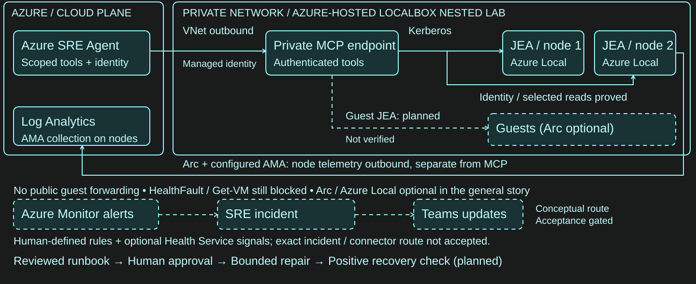

# Build a hybrid operations demo

Build a new Azure SRE Agent foundation, add five Windows monitoring rules, or
install a bounded, read-only Windows server diagnostic endpoint. Pick only the
components you need; **ordinary domain-joined Windows servers do not require
Azure Local, LocalBox or Arc for JEA diagnostics**.

**Start here as an attendee:** [readiness, minimum lab and scenario coverage](docs/attendee-readiness.md).
**One-server setup:** [gMSA and JEA](docs/guest-setup.md) ->
[publish and register the Windows MCP service](docs/mcp-service-install.md).
**Build your own reports:** [native report recreation and acceptance](docs/native-reports.md).
**No Azure environment yet:** try the [offline exercise](docs/walkthrough.md).
The guides use placeholders for your own environment. This is not a tested
whole-lab installer; live identity, connectivity and integration checks remain
your responsibility.

**PowerShell-first:** use PowerShell **7.5+** (`pwsh`) for the offline replay,
package checks and component tests; no Python installation is needed
for attendee workflows. Windows PowerShell 5.1 remains the guest JEA host.
Azure CLI/Bicep and .NET are required only for the components that use them.
One real Azure CLI SDK regression remains a **maintainer-only Python exception**,
not an attendee prerequisite; see [maintainer validation](docs/powershell-tooling.md).

## Choose your starting point

| What you want to build | Runnable component / instructions | Required environment |
| --- | --- | --- |
| A new SRE Agent with identity and telemetry resources | [SRE starter](infra/sre-agent-starter/README.md) | Existing approved Azure RG; Azure CLI, Bicep, PowerShell 7.2+ |
| Five Windows alert rules: heartbeat, CPU, physical memory, disk and counter coverage | [Monitoring baseline](infra/hybrid-monitoring/README.md) | Existing workspace and working AMA Heartbeat/Perf collection, explicit Arc server/Azure VM IDs |
| Observe Arc Available → Unavailable transitions | [Per-machine Arc connectivity](infra/hybrid-arc-connectivity/README.md) | Exact existing Arc machine IDs; **one rule per machine**, no workspace or broad-scope fallback |
| Bounded facts, Spooler state and recent System/Application events | [Windows JEA capability](tools/hybrid-server/README.md) | Domain-joined member server, Windows PowerShell 5.1, Kerberos/WSMan and dedicated nonadmin caller |
| Connect those reads to an SRE Agent over private MCP | [Portable MCP source](tools/private-mcp/README.md) | .NET 10 SDK; Windows host, explicit private configuration, TLS/Entra identity, network and JEA setup |
| Add missing Windows logical-disk counters | [Additive disk collection](infra/hybrid-monitoring-collection/README.md) | Exactly two existing Arc Windows servers in one RG and an existing workspace; ownership fingerprint receipt |
| Observe an English Spooler stopped transition | [Service-event monitoring starter](infra/hybrid-service-monitoring/README.md) | One existing Arc Windows Server guest with working AMA; DCR/association plus optional event rule; **offline source only** |
| Separately authorize a fixed Spooler start | [Spooler-only JEA recovery](tools/hybrid-service-recovery/README.md) | Approved noncritical member server and dedicated caller; **not connected to SRE** |
| Build an entire nested Azure Local learning environment | [Pinned official LocalBox and integration sequence](docs/localbox.md) | Upstream Azure, capacity, licensing, network and cost prerequisites |
| Recreate read-only native health/capacity reports | [Report contracts and source checklist](docs/native-reports.md) | Your own approved connector tools, scoped sources and authenticated native save/reopen/Reload verification |
| Add Azure Local triage knowledge without granting tools | [Neutral native skill and import/readback](docs/custom-skill.md) | Your own approved SRE Agent; additive skill save and activation check, no new tools or privileges |

## Architecture overview



[Open SVG](docs/diagrams/nic2026-demo-environment.svg) ·
[Editable Excalidraw source](docs/diagrams/nic2026-demo-environment.excalidraw)

This **conceptual** Azure-hosted LocalBox overview shows managed identity → private MCP →
Kerberos/JEA reads on two Azure Local nodes. Optional telemetry is a separate
path; guest, incident and repair paths are explicitly planned or acceptance-gated.
It is a reusable design overview, **not a live acceptance or health report**.
Ordinary-server diagnostics still do not require Azure Local or LocalBox.
For an ordinary-server deployment today, follow the [current trust-route
checklist](docs/guest-setup.md): private forwarder if needed → domain-joined
MCP service identity → fixed guest JEA endpoint. The workgroup forwarder does
not become a Kerberos execution identity. The diagram is not an
as-built deployment instruction.

### Quickstart: new SRE Agent

From the repository root:

```powershell
pwsh -NoProfile -File infra\sre-agent-starter\Test-Contracts.ps1
pwsh -NoProfile -File infra\sre-agent-starter\Test-Regression.ps1
bicep build infra\sre-agent-starter\main.bicep --stdout | Out-Null
```

Follow the [parameter, validate/what-if, deploy and ownership-checked cleanup
commands](infra/sre-agent-starter/README.md#iac-interface-powershell-72-installed-bicep-and-azure-cli).
Use a **new** agent, never adopt a shared one. Target Reader grants are opt-in;
Reader does not complete connector permissions. Native YAML/configuration is
**not yet delivered**. OAuth, supported native exports, network configuration
and end-to-end acceptance remain explicit manual steps in that guide.

### Quickstart: monitoring

```powershell
Copy-Item infra\hybrid-monitoring\config.example.json infra\hybrid-monitoring\config.local.json
Copy-Item infra\hybrid-monitoring\targets.example.json infra\hybrid-monitoring\targets.local.json
pwsh -NoProfile -File infra\hybrid-monitoring\tests\Test-Queries.ps1
pwsh -NoProfile -File infra\hybrid-monitoring\tests\Test-Scripts.ps1
pwsh -NoProfile -File infra\hybrid-monitoring\tests\Test-Template.ps1
```

Edit the private copies with your own approved bindings. Then follow
[preflight, preview, apply, validate and cleanup](infra/hybrid-monitoring/README.md#prepare-preview-apply-verify).
For portal Logs, select the **entire query with Ctrl+A**, including its final
tabular expression. See the
[full-query guidance](infra/hybrid-monitoring/README.md#running-the-complete-query-in-azure-logs).
Collection is a prerequisite. The optional
[disk-only DCR component](infra/hybrid-monitoring-collection/README.md) adds one
counter to exactly two Arc servers; it does not bootstrap all AMA collection.
The five-rule baseline does not implement Arc connection-state or current
service-state alerts. The separate service-event starter below observes a
historical transition, not current state.

### Quickstart: ordinary Windows server

Validate the portable source locally:

```powershell
pwsh -NoProfile -File tools\hybrid-server\Test-Offline.ps1
powershell.exe -NoProfile -File tools\hybrid-server\Test-Offline.ps1
pwsh -NoProfile -File tools\hybrid-server\Test-OwnershipOffline.ps1
```

On an approved member server, copy `tools\hybrid-server`, then use elevated
Windows PowerShell 5.1:

```powershell
.\Install-HybridServerReadOnly.ps1 -CallerIdentity 'EXAMPLE\mcpRead$' -WhatIf
# After approval, repeat without -WhatIf.
# For a caller with an approved process under its own identity:
.\Test-HybridServerReadOnly.ps1 -ComputerName server01.example.test `
    -ExpectedMachine SERVER01 -ExpectedCaller 'EXAMPLE\mcpRead$'
# After sessions end and separately owned provider grants are rolled back:
.\Remove-HybridServerReadOnly.ps1 -WhatIf
```

Read the [full setup/cleanup contract](tools/hybrid-server/README.md) before
installation. No arbitrary shell, service remediation, directory account,
provider ACL grant or live WinRM restart is supplied.
For a gMSA, follow the [account creation and actual-service testing route](docs/guest-setup.md):
do not run that probe as the installer or try to log on interactively as the gMSA.

### Quickstart: portable MCP source, not an appliance

```powershell
dotnet restore tools\private-mcp\tests\PrivateMcp.Tests.csproj --locked-mode
dotnet test tools\private-mcp\tests\PrivateMcp.Tests.csproj --no-restore
dotnet build tools\private-mcp\src\PrivateMcp.csproj --configuration Release --no-restore
dotnet publish tools\private-mcp\src\PrivateMcp.csproj --configuration Release `
    --runtime win-x64 --self-contained false --no-restore `
    --output tools\private-mcp\src\bin\publish\win-x64
```

The capability names are `get_server_facts`,
`get_server_service_state` and `get_server_events`. The supplied
[server allowlist example](tools/private-mcp/servers.example.json) is only a
configuration fragment. `ListenAddress` and `AllowedSourceCidrs` are now required
operator configuration, with no lab-address fallback. The unchanged sample
intentionally fails identity validation. Follow the [build, TLS, service identity,
private network and migration instructions](tools/private-mcp/README.md); service
registration and guest setup are separate, not an instant appliance installer.
Keep LocalBox node capabilities disabled for ordinary servers.
The optional node mode retains LocalBox-specific target, domain, identity and
module-path contracts; these are not portable turnkey bindings for your lab.
Ordinary-server setup uses your explicit server allowlist instead. The
[source attribution and manifest](THIRD-PARTY.md) record component origins;
attendees do not need access to the original private source repository.
The [installation guide](docs/mcp-service-install.md) covers runtime prerequisites,
directory/config/key permissions, quoted gMSA SCM registration and scoped removal.
Native private routing and renewable app-only authentication require separate
configuration and verification in your environment.

### Optional: disk collection and fixed service recovery

```powershell
bicep build infra\hybrid-monitoring-collection\main.bicep --stdout | Out-Null
pwsh -NoProfile -File infra\hybrid-monitoring-collection\tests\Test-Collection.ps1
pwsh -NoProfile -File tools\hybrid-service-recovery\Test-Offline.ps1
pwsh -NoProfile -File tools\hybrid-service-recovery\Test-InstallerOffline.ps1
```

Read the collection guide's exact three-resource what-if and
`New-CollectionReceipt` instructions before separately approved deployment.
Legacy receipts without proven original snapshots/fingerprints do **not**
authorize cleanup. If original snapshots are missing or overwritten, stop for
ownership review. Never reconstruct ownership from current GET responses.

Spooler recovery exposes only a fixed state read and `Start-HybridSpooler`.
It has no fault injection, arbitrary service control, MCP write tool or native
approval integration. Follow its [installation and ownership cleanup guide](tools/hybrid-service-recovery/README.md);
do not grant an SRE identity write access until native human-approval behavior
is independently proved.

### Optional: English Spooler stopped-transition monitoring

```powershell
pwsh -NoProfile -File infra\hybrid-service-monitoring\tests\Test-Contract.ps1
bicep build infra\hybrid-service-monitoring\main.bicep --stdout | Out-Null
bicep build-params infra\hybrid-service-monitoring\example.bicepparam --stdout | Out-Null
```

The [self-contained starter](infra/hybrid-service-monitoring/README.md) defines
one DCR/association and an optional English 7036 stopped-transition alert.
It does not install AMA, grant RBAC, monitor continuous current state or prove
native human approval. Verify the exact guest event XML and ingested schema
before enabling its optional rule. **Zero matching events means UNKNOWN**;
an old stop aging out is not recovery. The rule does not automatically resolve.
Follow its manual staging, ownership and exact-ID cleanup instructions; the
five-rule baseline's cleanup script does not apply to these resources.

### What is not ready

There is no complete native-agent configuration or whole-lab installer.
End-to-end Kerberos/WinRM/JEA and native SRE integration require verification
in your environment. A registered connector with configured tool visibility can
still be undiscoverable in a main-agent conversation; require fresh correlated
calls, not only configuration readback. Native incident routing, human approval,
final Teams notification and guest recovery are not delivered end to end.

### Optional: per-machine Arc connectivity

```powershell
bicep build infra\hybrid-arc-connectivity\main.bicep --stdout | Out-Null
bicep build-params infra\hybrid-arc-connectivity\main.example.bicepparam --stdout | Out-Null
pwsh -NoProfile -File infra\hybrid-arc-connectivity\Test-Connectivity.ps1
```

Each rule has one exact machine scope and a flat `resourceId` equality for that
same machine. **Four targets create four rules and consume four activity-log
rule slots**, not one. There is no resource-group/subscription scope fallback.
Follow the component's offline parameter gate and separately authorized manual
preflight; compilation never authorizes deployment.

Verify provider acceptance in your environment after deployment. This signal
is an Available → Unavailable event, not current inventory: zero events is
UNKNOWN. Native routing, Teams delivery and recovery require separate checks.

## Guides and optional illustrations

- [Setup, permissions and costs](docs/setup.md)
- [LocalBox upstream and sequencing](docs/localbox.md)
- [Reference architecture](docs/reference-architecture.md)
- [Safety and cleanup](docs/safety-and-reset.md)
- [Optional offline exercise](docs/walkthrough.md)
- [Future scenario ideas](docs/scenario-ideas.md) — conceptual only, not implemented
  or end-to-end validated: certificate expiry, configuration drift, backup
  freshness and application dependency triage.
- [Optional Copilot/Claude → SRE Agent MCP bonus](docs/sre-agent-mcp-client-bonus-demo.md)
  — documentation-verified client setup and bounded existing-thread reads;
  integration remains untested, with no new investigation or remediation.
- [Source references](docs/sources.md), [attribution](THIRD-PARTY.md)
- [Local validation and maintainer checks](docs/powershell-tooling.md)

### Microsoft SRE Agent hands-on labs

Explore Microsoft's [SRE Agent labs feature branch](https://github.com/microsoft/sre-agent/tree/feature/onboarding-agent-workflows/labs)
and the [five pinned lab/connector references](docs/sources.md#microsoft-sre-agent-labs-and-report-connectors).
The reviewed snapshot is `1b30297529fcef0411ad64c56e60500a5a3a8e61`
(September 18, 2026), not a release. These are **external links only**;
revalidate compatibility before using them.

Use the scheduled-health and report examples as separate learning exercises.
The scheduled instructions prohibit updating reports; successful subagent
queries do not establish report-tool eligibility. Verify your actual configured
connector, supported report tools and scoped queries before separately approving
one read-only report save → gallery → reopen → Reload test. Do not import
autonomous incident routes, broad policies, enabled schedules or email settings
from the lab.

The preserved synthetic examples are optional teaching illustrations, not live
evidence or the purpose of this starter:

```powershell
pwsh -NoProfile -File scripts\Invoke-Replay.ps1 -Scenario all
pwsh -NoProfile -File tests\Test-Replay.ps1
```

**Do not ingest this repository into agent knowledge.** It includes expected
answers and exercise material. Restrict any knowledge connector to separately
reviewed neutral runbooks; never ingest fault scripts, private bindings or raw
operational results. The optional [native skill](docs/custom-skill.md) has its
own import and verification instructions.

Original code and prose retain the [MIT license](LICENSE).
Linked third-party content is not vendored or relicensed.
